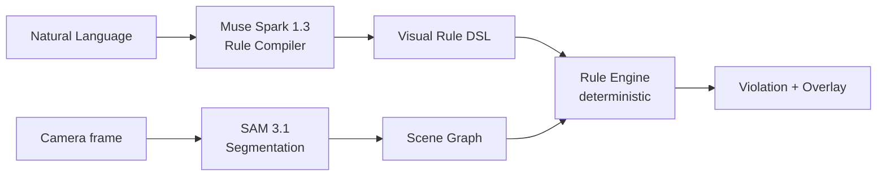

# WorldDebugger

[English](README.md) | [日本語](README.ja.md)

> ソフトウェアにはリンターがある。物理世界にはない。

WorldDebuggerは、**現実世界のルールを自然言語で定義**し、カメラ映像を監視して違反を画面上にハイライトするアプリです。

- `Keep drinks away from laptops.` → コップがラップトップに近づくと⚠ Spill risk
- `Keep this doorway clear.` → 物体がゾーンに入ると⚠ Blocked access
- 物体をどかす → ✓ Resolved

## コンセプト

**自然言語 → 実行可能なビジュアルルール。** 固定の検出器しか持たないCV製品とは異なり、ユーザーが新しいビジュアルルールを自分で作れます。Muse Sparkがルールをコンパイルし、SAM 3.1がシーンを認識し、決定論的エンジンが違反を判定します。

## アーキテクチャ



- LLMの役割：言語理解、DSL生成、説明文の生成。
- Pythonの役割：bboxのIoU、中心点・正規化距離、ゾーン判定、継続時間の計測。
- LLMは幾何計算を行いません。

## Meta AIの利用

- **Muse Spark (`muse-spark-1.3`)**：Structured Outputによるルールコンパイラ。
  Pydanticの`VisualRule`スキーマをレスポンスのJSONスキーマとして渡します。
- **SAM 3.1 (`sam-3.1`)**：Responses / Media Segmentation APIによる認識レイヤー。
  コンセプトごとに短い名詞句1つをプロンプトにします
  （`cup`、`laptop` — `cup or bottle`のような複合は不可）。
- ベースURLは`https://api.meta.ai/v1`で、OpenAI互換クライアントを使います。
- 両モデルは中心的な構成要素であり、付け足しではありません。

## セットアップ

前提条件：Python 3.11+（`uv`経由）、Node 24+。

```bash
cp .env.example backend/.env   # MODEL_API_KEYを設定し、ライブモードではMOCK_META_API=falseに
cd backend && uv sync
cd ../frontend && npm install
```

## 環境変数

| 名前 | 意味 |
| ---- | ---- |
| `MODEL_API_KEY` | Meta Model APIキー（コミット厳禁） |
| `MODEL_BASE_URL` | 既定値 `https://api.meta.ai/v1` |
| `RULE_MODEL` | 既定値 `muse-spark-1.3` |
| `SEGMENTATION_MODEL` | 既定値 `sam-3.1` |
| `MOCK_META_API` | `true` = オフラインのフィクスチャ、`false` = ライブのMeta API |
| `REQUEST_TIMEOUT_S` / `MAX_RETRIES` / `SAM_CACHE_TTL_S` | 信頼性の調整 |

## 開発コマンド

```bash
cd backend
uv run pytest                 # 単体 + APIテスト
MOCK_META_API=true uv run python -m app.benchmark   # ベンチマークハーネス
cd ../frontend
npx tsc --noEmit && npm run build
```

## フロントエンド / バックエンドの起動

```bash
# ターミナル1 — backend (http://127.0.0.1:8000)
cd backend && uv run uvicorn app.main:app --port 8000

# ターミナル2 — frontend (http://localhost:8100)
cd frontend && npm run dev
```

ブラウザで http://localhost:8100 を開きます。開発サーバーが`/api`をバックエンドにプロキシします。
（517x番台は他プロジェクトが使うため、このプロジェクトは8100を使います。）

## UIツアー

- フルスクリーンのカメラ映像。ストリームがない場合は中央に**Start camera**
  ボタンが表示されます。
- ボトムシートにはグラバー付き：タップまたは引き上げるとRules、
  Camera、Zones、Issues、オフラインのデモが現れます。引き下げると閉じます。
- ドック（常時表示）には**Analyze**、**Auto**トグル、
  **Draw zone**があります。
- Cameraセクション（シート内）：カメラ選択（2台以上ある場合）、
  横倒し設置カメラ用の⟳回転ボタン（0/90/180/270°、ブラウザに保存）、
  Restart camera、リアルタイムの解像度表示。
- 違反は赤いマスク輪郭＋フローティングトーストで表示されます。エラーも
  シート上部のトーストに出ます。

## デモシナリオ

デモ1（空間）：シートを引き上げ、`Keep drinks away from laptops.`と入力 →
Create Rule → `✓ Visual rule compiled` → コップをラップトップに近づける →
Analyze（またはAuto）→ 赤い輪郭付きで⚠ Spill Risk → 遠ざける → ✓ Resolved。

デモ2（ゾーン）：映像上でDraw zone、名前を`doorway`に →
`Keep this doorway clear.` → ゾーン内に箱を置く → ⚠ Blocked access →
取り除く → ✓ Resolved。

カメラがない場合：「Demo without camera」ボタンを使います（フィクスチャ映像、モックモードのみ）。

ルールは`backend/rules.json`に保存され、バックエンド再起動後も残ります。Auto解析は
APIコスト節約のため3分で自動停止します。

## 現在の制限

- スナップショット解析（1〜3秒間隔）であり、30fpsのリアルタイムAIでは
  ありません。クラウドSAMを30fpsで毎フレーム呼ぶのは非現実的です
  （数秒の遅延＋リクエストごとのコスト）。SAM 3紹介ページは最適化された
  インタラクティブデモであり、ブラウザAPIを毎フレーム呼ぶものではありません。
- マスク輪郭はSAMマスクトークンから描画します（公式`meta-sam-parser`の
  デコード＋境界追跡）。ボックスだけでなく輪郭が出ます。
- 距離は画像空間で正規化したもの。実寸の奥行きは扱いません
  （`requires_metric_depth`のルールは推測せず警告を表示）。
- ルールは`backend/rules.json`に保存。ゾーンは長方形のみ。
- モックモードのフィクスチャは開発用の固定レイアウトです。
- USB／仮想カメラはUVC経由で横長1920×1080が上限。横倒し設置のカメラには
  ⟳ボタンを使います。

## 今後の展望

時間追跡の仕上げ、多角形ゾーンの編集、ルールの永続化、
マルチカメラ、ステレオ／RGB-Dによる実寸奥行き、製造・アクセシビリティ・
組み立て向けパック、モバイルアプリ、認証／アカウント（いずれも現時点では非目標）。

ベンチマーク（モックのフィクスチャ、`python -m app.benchmark`で計測）：
4シナリオ中、検出2、見逃し0、誤検出0。
学習不要。新規ルール作成にラベル付きデータセットは不要です。
