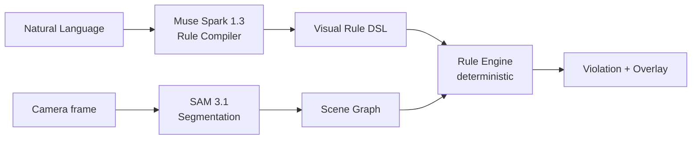

# WorldDebugger

> Software has linters. The physical world doesn’t.

WorldDebugger lets users define **real-world rules in natural language**,
then watches the camera feed and highlights violations on screen.

- `Keep drinks away from laptops.` → ⚠ Spill risk when a cup is near a laptop
- `Keep this doorway clear.` → ⚠ Blocked access when a box enters the zone
- Move the object away → ✓ Resolved

## Core concept

**Natural language → executable visual rule.** Unlike fixed-detector CV products,
users create new visual rules themselves. Muse Spark compiles the rule,
SAM 3.1 perceives the scene, and a deterministic engine judges violations.

## Architecture



- LLM does: language understanding, DSL generation, explanations.
- Python does: bbox IoU, centroid/normalized distance, zone tests, durations.
- The LLM never computes geometry.

## Meta AI usage

- **Muse Spark (`muse-spark-1.3`)**: rule compiler with Structured Output —
  the Pydantic `VisualRule` schema is passed as the response JSON schema.
- **SAM 3.1 (`sam-3.1`)**: perception layer via the Responses / Media
  Segmentation API, one short noun-phrase prompt per concept
  (`cup`, `laptop` — never `cup or bottle`).
- Base URL `https://api.meta.ai/v1`, OpenAI-compatible client.
- Both models are central to the product, not add-ons.

## Setup

Prerequisites: Python 3.11+ (via `uv`), Node 24+.

```bash
cp .env.example backend/.env   # then set MODEL_API_KEY, MOCK_META_API=false for live mode
cd backend && uv sync
cd ../frontend && npm install
```

## Environment variables

| Name | Meaning |
| ---- | ------- |
| `MODEL_API_KEY` | Meta Model API key (never commit) |
| `MODEL_BASE_URL` | Default `https://api.meta.ai/v1` |
| `RULE_MODEL` | Default `muse-spark-1.3` |
| `SEGMENTATION_MODEL` | Default `sam-3.1` |
| `MOCK_META_API` | `true` = offline fixtures, `false` = live Meta API |
| `REQUEST_TIMEOUT_S` / `MAX_RETRIES` / `SAM_CACHE_TTL_S` | Reliability tuning |

## Development commands

```bash
cd backend
uv run pytest                 # unit + API tests
MOCK_META_API=true uv run python -m app.benchmark   # benchmark harness
cd ../frontend
npx tsc --noEmit && npm run build
```

## How to run frontend/backend

```bash
# terminal 1 — backend (http://127.0.0.1:8000)
cd backend && uv run uvicorn app.main:app --port 8000

# terminal 2 — frontend (http://localhost:8100)
cd frontend && npm run dev
```

Open http://localhost:8100 in a browser. The dev server proxies `/api` to the backend.
(517x is used by other projects, so this project uses 8100.)

## Demo scenario

Demo 1 (spatial): type `Keep drinks away from laptops.` → Create Rule →
`✓ Visual rule compiled` → hold a cup near a laptop → ⚠ Spill Risk with red
overlays → move it away → ✓ Resolved.

Demo 2 (zone): Draw zone on the overlay, name it `doorway` →
`Keep this doorway clear.` → put a box in the zone → ⚠ Blocked access →
remove it → ✓ Resolved.

No camera? Use “Demo without camera” buttons (fixture frames).

## Current limitations

- Snapshot analysis (1–3s), not 30fps realtime AI. Per-frame cloud SAM at
  30fps is infeasible (seconds of latency + cost per request); the SAM 3 intro
  page runs an optimized interactive demo, not per-frame browser API calls.
- Mask contours are drawn from SAM mask tokens (official `meta-sam-parser`
  decode + boundary tracing), so objects get outlines, not just boxes.
- Distances are image-space normalized; no metric depth
  (`requires_metric_depth` rules show a warning instead of guessing).
- Rules store is in-memory; zones are rectangles.
- Mock mode fixtures are fixed layouts for development.

## Future work

Temporal tracking polish, polygon zone editing, persistent rules,
multi-camera, metric depth with stereo/RGB-D, manufacturing/accessibility/
assembly-specific packs, mobile app, auth/accounts (all explicit non-goals now).

Benchmark (mock fixtures, measured via `python -m app.benchmark`):
4 scenarios, 2 detected, 0 missed, 0 false positives.
No training. No labeled dataset required to create a new rule.
