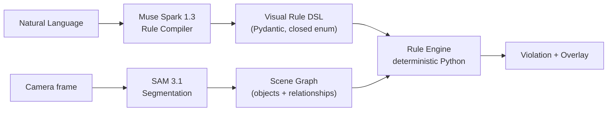

# WorldDebugger — implementation plan

## Goal

Hackathon MVP: `Natural language → Meta AI → executable visual rule → real-world violation`
をブラウザデモで成立させる。審査員の前で新しいルールを入力し、数秒後にカメラ映像上で発火する。

## Architecture

- LLM がやること: 自然言語理解、DSL 生成、説明文生成のみ。
- 数値 geometry (IoU, 距離, zone 判定, duration) は Python で決定的に計算。LLM に計算させない。

## Data model

- `VisualRule`: id, name, original_text, description, severity, selectors, condition, explanation
- `Selector`: id, concept, sam_prompt (単一オブジェクトの短い noun phrase。`cup` と `bottle` は別 selector)
- `Condition`: operator (closed enum: `near|far_from|overlaps|inside_zone|outside_zone|present_for|absent_for|not_near_for`),
  subject, object, threshold (image-space normalized), zone_id, duration_seconds, requires_metric_depth
- `SceneObject`: id, concept, bbox [0..1], confidence, centroid
- `Violation`: rule_id, rule_name, severity, message, object_ids, timestamp

距離は image-diagonal 正規化距離のみ。物理単位 (30cm等) は `requires_metric_depth=true`
として保持し、推定せず UI で「metric depth 未対応」と表示する。

## Build order (spec §22)

1. P0: camera → backend frame 送信 → SAM segmentation → bbox overlay
2. P1: NL → Muse Spark → DSL → SceneGraph → rule evaluation → violation overlay → Resolved
3. P2: zone rules (矩形; polygon は bbox 近似ではなく point-in-polygon で正確に)
4. P3: temporal rules (IoU/nearest-neighbor の軽量 tracker + `present_for` 等)
5. P4: benchmark / polish

P0/P1 の動作確認なしに P2 以降へ進まない。

## Backend (Python 3.11, FastAPI, Pydantic, OpenAI SDK互換)

- `app/models/dsl.py` — DSL 型 (closed enum)
- `app/models/scene.py` — SceneGraph 型
- `app/services/meta_client.py` — Meta Model API  thin client (timeout/retry/エラーを集約)
- `app/services/rule_compiler.py` — Muse Spark Structured Output + mock fallback
- `app/services/segmentation.py` — SAM 3.1 (concept ごとに request、結果 cache)
- `app/services/geometry.py` — IoU/距離/zone 判定 (pure, unit test)
- `app/services/scene_graph.py` — detection → scene graph 構築
- `app/services/rule_engine.py` — 決定的評価 + tracker
- `app/api/routes.py` — `/api/rules/compile`, `/api/rules`, `/api/analyze`, `/api/health`
- `MOCK_META_API=true` で fixture ベース開発 (本番 UI では mock を実データとして表示しない)

## Frontend (React + TS + Vite, Canvas overlay)

- `getUserMedia` preview (realtime) + snapshot 解析 (1〜3s polling / Analyze ボタン)
- 状態: idle/capturing/analyzing/safe/violation/error
- Canvas overlay: safe=subtle outline, violation=赤系 overlay + label + rule name
- Zone editor: video 上に矩形 zone を描画 (P2)
- Rules panel / Issues panel / Resolved トースト
- フッターに `Powered by Muse Spark 1.3 + SAM 3.1` (mock 時は `Mock mode` を明示)

## Reliability (§15)

- network timeout, retry 上限, user-visible error, malformed response 処理, empty segmentation 処理
- SAM 結果を短時間 cache、不要な再 request を避ける

## Testing (§17)

- compiler schema (valid/invalid/ambiguous), geometry, rule engine (violation/no-violation/resolved), API (mock)
- `pytest` がゲート。frontend は `tsc` + `vite build`

## Docs

- `docs/decisions.md` にデフォルト選択を記録 (質問せず進める)
- `README.md` (§20 の11項目 + Mermaid 図)
- `.env.example` (`MODEL_API_KEY`, `MOCK_META_API`)
